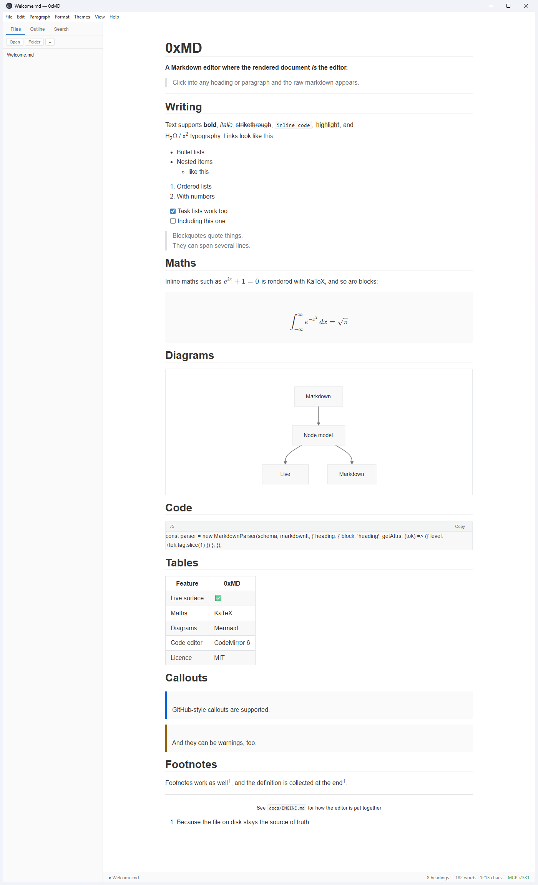
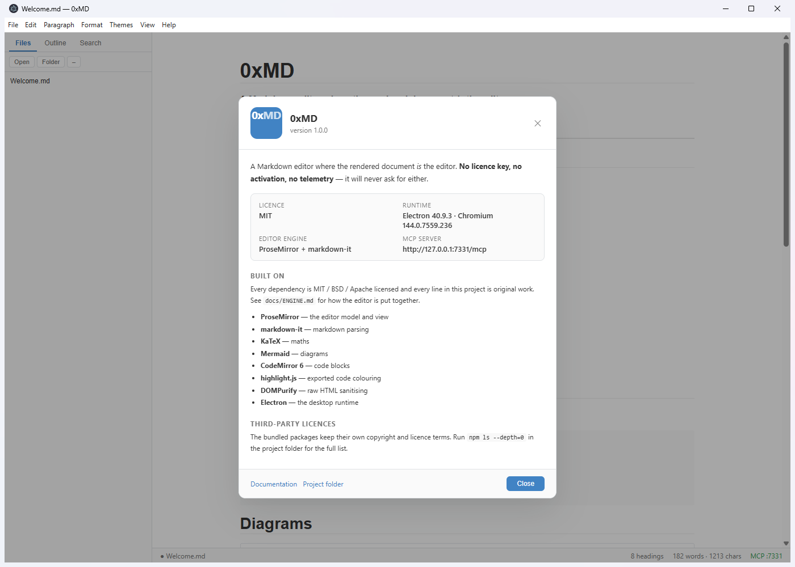
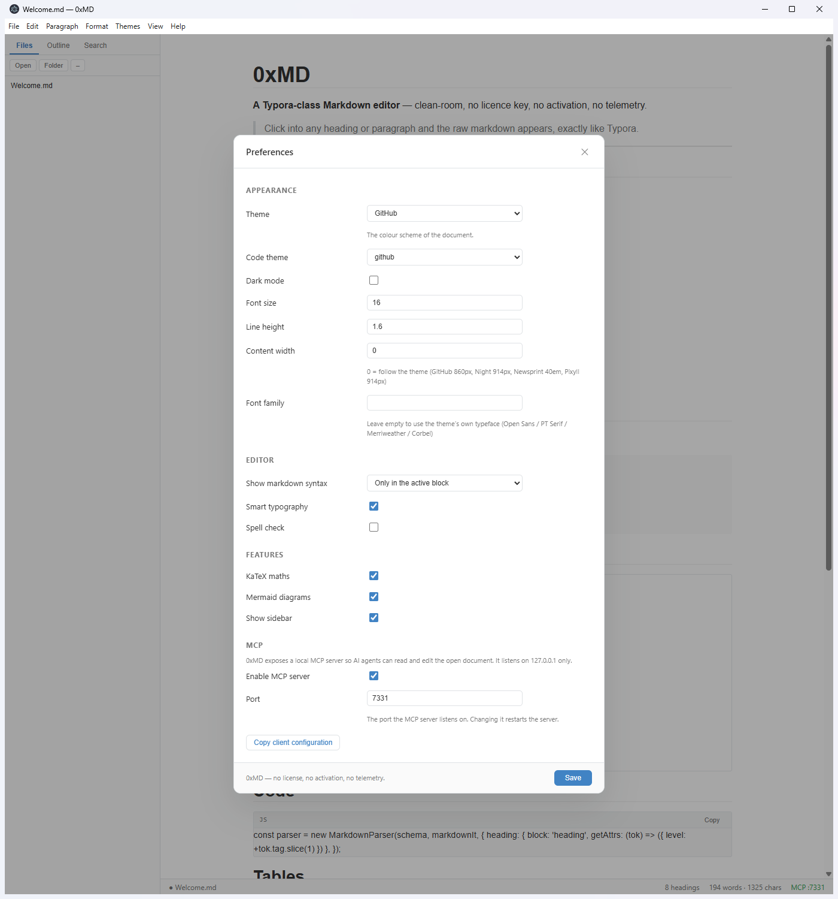
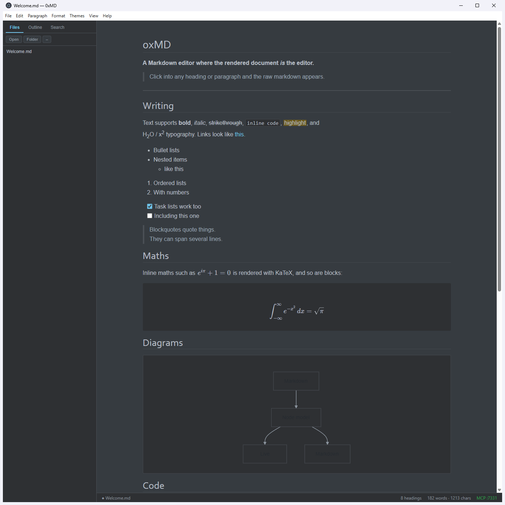

# 0xMD

**A Markdown editor where the rendered document _is_ the editor. No licence key, no activation, no telemetry.**

---

0xMD reads and writes `.md` files the way a writing tool should: you type
markdown syntax and watch it become a heading, a table, a formula or a
diagram **in place**. There is no preview pane — the document you are editing
*is* the rendered document.

| | |
|---|---|
| **Live editing** | Markdown markers are hidden until you click into the block. |
| **Document vocabulary** | Front matter, maths, Mermaid, callouts, footnotes, task lists, tables, alerts, raw HTML. |
| **Real code editor** | Fenced blocks open in CodeMirror 6 with syntax highlighting. |
| **Live maths** | `$x$` inline and `$$x$$` block, rendered with KaTeX, click to edit the source. |
| **Diagrams** | Mermaid, loaded lazily — only when a document actually contains one. |
| **Outline & file tree** | Sidebar with headings, a folder tree, a folder-wide search and a file preview on hover. |
| **Find & replace, quick open** | `Ctrl+F` and `Ctrl+P`. |
| **Themes** | GitHub, Newsprint, Night, Pixyll. |
| **Export** | Standalone HTML (syntax highlighted) and PDF. |
| **MCP server** | Lets an AI agent read and edit the open document — and it can be switched off. |

## Screenshots

| | |
|---|---|
|  | The whole surface: maths, a diagram, code, tables, callouts, footnotes. |
|  | The about dialog. |
|  | Preferences, including the MCP section. |
|  | The Night theme. |

## Licence

* Every dependency is MIT / BSD / Apache licensed.
* **0xMD itself is MIT licensed** and will never require a licence key.
* Nothing is phoned home. The MCP server binds to `127.0.0.1` only.

---

## Installing

| Platform | File | Notes |
|---|---|---|
| Windows | `0xMD-*-portable.exe` | A single file — run it, no installation. |
| Windows | `0xMD-*-setup.exe` | A regular installer with a shortcut. |
| macOS | `0xMD-*.dmg` | Drag **0xMD** into your Applications folder. |
| macOS | `0xMD-*.zip` | The bare `.app` bundle. |

The macOS build is **not signed**, so Gatekeeper quarantines it on first
launch. Either right-click the app and choose **Open**, or clear the
quarantine flag once:

```bash
xattr -cr /Applications/0xMD.app
```

> The macOS artefacts are produced by the
> [release workflow](.github/workflows/release.yml), which runs the macOS
> build on a `macos-latest` runner — a `.dmg` has to be assembled with
> Apple's own tooling, so it cannot be produced from Windows or Linux.

## Running it

```bash
npm install
npm run dev      # Vite dev server + Electron
npm start        # production build, then Electron
npm run smoke    # headless self-test against the real DOM
```

Packaging a portable Windows executable:

```bash
npm run dist     # → release/0xMD-1.0.0-portable.exe
```

### Opening files from the command line

```bash
0xMD.exe notes.md                 # open a document
0xMD.exe ./notes                  # open a folder in the sidebar
0xMD.exe ./notes notes/todo.md    # both
```

## The demo document

`demo/Welcome.md` exercises every feature at once — headings, every inline
mark, maths, a Mermaid diagram, a syntax-highlighted code block, a table,
task lists, callouts and footnotes. Open it to see the whole surface.

Screenshots in `demo/` were captured with the helper scripts in `tools/`
(`capture.ps1`, `interact.ps1`), which drive the real window and grab the
screen — handy for regenerating them after UI changes.

## The MCP server

0xMD runs a [Model Context Protocol](https://modelcontextprotocol.io) server
inside the main process:

```
POST http://127.0.0.1:7331/mcp     → JSON-RPC
GET  http://127.0.0.1:7331/mcp     → server→client stream
```

Point any MCP client at it:

```json
{
  "mcpServers": {
    "0xmd": {
      "url": "http://127.0.0.1:7331/mcp"
    }
  }
}
```

The **Preferences** dialog has an *MCP* section where the server can be
switched on or off, moved to another port, and its client configuration
copied to the clipboard. The status bar always shows the current state.

### Tools

| Tool | What it does |
|---|---|
| `open_document` | Open a `.md` file in the editor |
| `read_document` | Read the markdown source of the open document |
| `read_file` | Read any markdown file from disk without opening it |
| `get_outline` | Heading tree of the open document |
| `list_documents` | Every markdown file in the opened folder |
| `search_documents` | Grep the opened folder |
| `insert_text` | Insert text at the cursor |
| `replace_selection` | Replace the selected text |
| `append_text` | Append text at the end of the document |
| `save_document` | Write the document back to disk |
| `export_document` | Export as HTML or PDF |
| `set_theme` | Switch the colour theme |
| `configure_mcp` | Switch the MCP server on/off or move it to another port |
| `open_preferences` | Open the preferences dialog |
| `open_about` | Open the about dialog |
| `open_find` | Open find & replace |
| `toggle_sidebar` | Show or hide the sidebar |
| `get_settings` | Read the current preferences |
| `get_app_info` | Version, open file, MCP status |

### Resources

`oxmd://document/current` — the open document as `text/markdown`.

### Why edits are safe

The MCP server never touches the DOM. Every mutation is sent to the renderer
as a named command and executed there as a **ProseMirror transaction**, so the
undo history stays intact, a partially applied change is impossible, and the
file on disk stays the source of truth.

## Architecture

```
electron/
  main.js            main process — windows, menus, IPC, file system, MCP lifecycle
  preload.cjs        contextBridge surface (contextIsolation + sandbox ON)
  mcp.js             MCP server (Streamable HTTP, loopback only)
  watcher.js         chokidar file watcher
  smoke.js           headless self-test script

src/
  core/
    schema.js        the node model — every block and inline type
    markdown-it.js   markdown-it + custom rules (math, front matter, alerts, task lists)
    parser.js        markdown  → node model
    serializer.js    node model → markdown
    editor.js        ProseMirror view + plugin stack
    nodeviews/       KaTeX, Mermaid, CodeMirror, footnotes, raw HTML, task checkbox
    plugins/         hidden markers, keymap, input rules, live styles, placeholder
  ui/                outline, file tree, find, quick open, settings
  styles/            base, editor, sidebar, and four themes

tests/
  pipeline.test.js   markdown round-trip guarantees (17 assertions)
  mcp.test.js        end-to-end MCP client against the running app
  mcp-config.test.js the MCP server can be reconfigured at runtime
```

The document model is a three-stage pipeline:

```
markdown ──parser──▶ node model ──serializer──▶ markdown
                         │
                         └──────▶ the live DOM you edit
```

## Round-trip guarantee

The file on disk is the source of truth, so 0xMD guarantees that

```
parse(markdown) → node model → serialize(node model) → markdown
```

preserves your document. `tests/pipeline.test.js` asserts this for front
matter, headings, every inline mark, maths, code fences, Mermaid blocks,
tables, callouts, task lists, footnotes, images and links — and that the
result is idempotent.

```bash
npm test           # pipeline
npm run test:all   # pipeline + MCP end-to-end + MCP configuration
```

## Keyboard shortcuts

| | |
|---|---|
| `Ctrl+O` / `Ctrl+Shift+O` | Open file / open folder |
| `Ctrl+S` / `Ctrl+Shift+S` | Save / Save as |
| `Ctrl+F` / `Ctrl+P` | Find / quick open |
| `Ctrl+,` | Preferences |
| `Ctrl+B` `Ctrl+I` | Bold / italic |
| `Ctrl+Shift+X` `Ctrl+Shift+H` | Strikethrough / highlight |
| `Ctrl+Alt+1…6` / `Ctrl+Alt+0` | Heading 1…6 / paragraph |
| `Ctrl+Shift+8` `Ctrl+Shift+7` | Bullet list / ordered list |
| `Ctrl+Shift+Q` | Quote |
| `Ctrl+Shift+L` | Toggle sidebar |
| `Ctrl+/` | Source code mode |

## Licence

MIT. The bundled third-party packages keep their own licences; see
`node_modules` after `npm install`.
