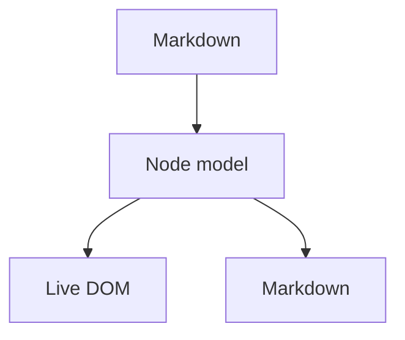

# 0xMD

**A Markdown editor where the rendered document _is_ the editor.**

> Click into any heading or paragraph and the raw markdown appears.

---

## Writing

Text supports **bold**, *italic*, ~~strikethrough~~, `inline code`, ==highlight==, and
H~2~O / x^2^ typography. Links look like [this](https://commonmark.org/help/).

- Bullet lists
- Nested items
  - like this

1. Ordered lists
2. With numbers

- [x] Task lists work too
- [ ] Including this one

> Blockquotes quote things.
> They can span several lines.

## Maths

Inline maths such as $e^{i\pi} + 1 = 0$ is rendered with KaTeX, and so are blocks:

$$
\int_{-\infty}^{\infty} e^{-x^2}\,dx = \sqrt{\pi}
$$

## Diagrams



## Code

```js
const parser = new MarkdownParser(schema, markdownIt, {
  heading: { block: 'heading', getAttrs: (tok) => ({ level: +tok.tag.slice(1) }) },
});
```

## Tables

| Feature | 0xMD |
| --- | --- |
| Live surface | ✅ |
| Maths | KaTeX |
| Diagrams | Mermaid |
| Code editor | CodeMirror 6 |
| Licence | MIT |

## Callouts

> [!NOTE]
> GitHub-style callouts are supported.

> [!WARNING]
> And they can be warnings, too.

## Footnotes

Footnotes work as well[^why], and the definition is collected at the end[^why].

[^why]: Because the file on disk stays the source of truth.

---

<div align="center">
  <sub>See <code>docs/ENGINE.md</code> for how the editor is put together</sub>
</div>
